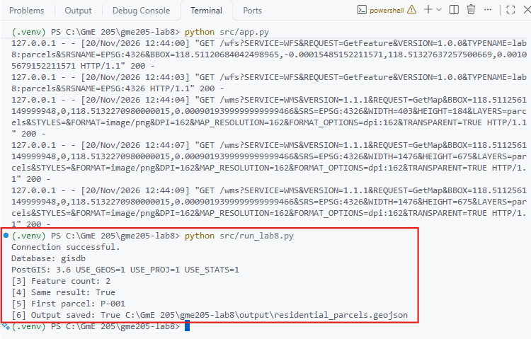
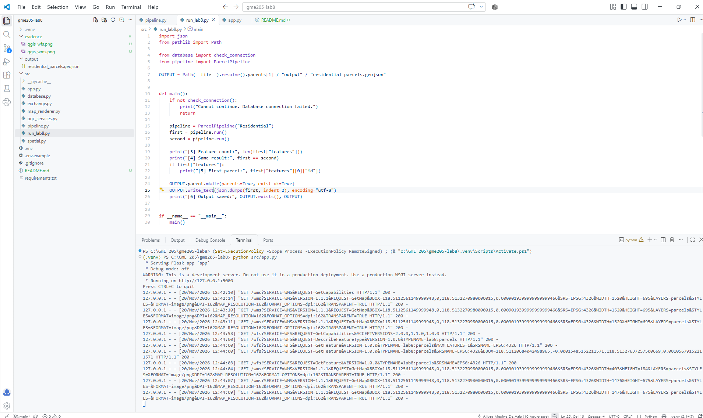
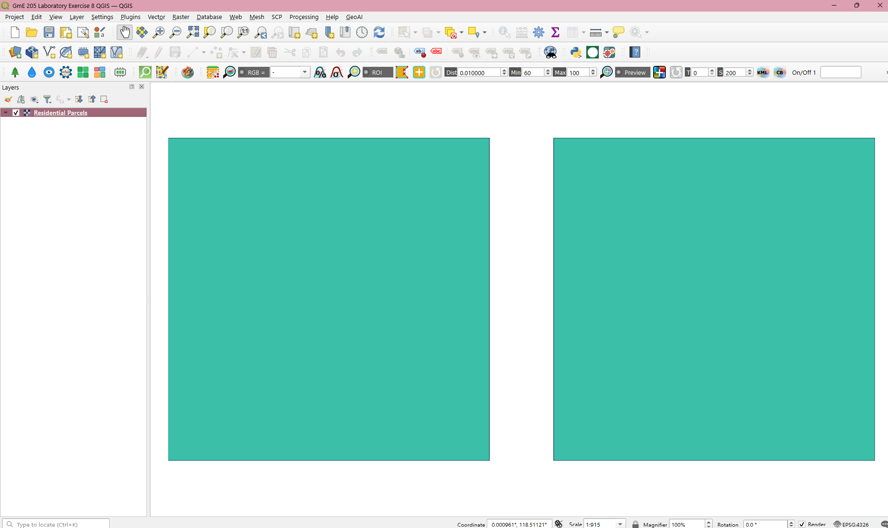
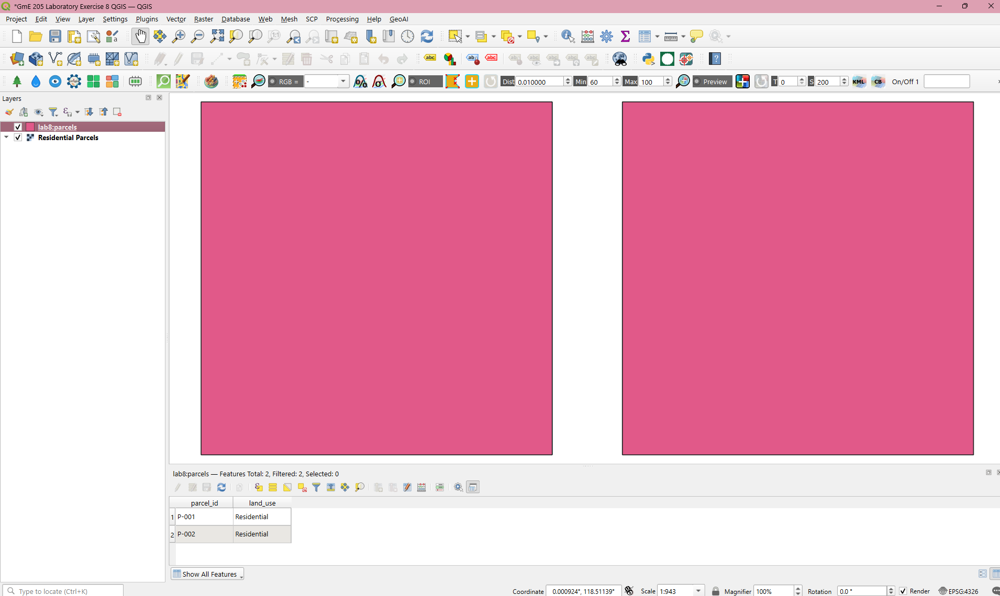

# Programming Exercise 8
## Reproducible Geoprocessing, Flask Services, and QGIS WMS/WFS Clients

### Introduction to the Programming Exercise
This laboratory exercise reuses the previous python, PostGIS, and GeoJSON components to automate one research query, verify its repeatability, and expose the result through a local Flask GET endpoint.

The objective of this laboratory is to develop a reusable object-oriented pipeline that connects PostgreSQL/PostGIS, Python objects, and GeoJSON. Additionally, the exercise demonstrated how spatial data can be processed consistently, producing the same results from repeated executions using the same input data. The laboratory focuses on creating a Flask service that allows geographic data to be accessed through HTTP requests and visualized in QGIS using WMS and WFS. Lastly, it showed the differences between raster map outputs and vector features, while understanding the limitations of the implemented services.

### Materials/Tools
1. Python
2. Flask
3. PostgreSQL/PostGIS
4. pgAdmin Query Tool
5. psycopg 3
6. python-dotenv
7. JSON
8. VS Code
9. Git
10. Edge Browser

### Project Structure
gme205-lab8/ 
├── src/ 
│   ├── database.py         
│   ├── spatial.py          
│   ├── exchange.py         
│   ├── pipeline.py         
│   ├── run_lab8.py         
│   ├── app.py              
│   ├── map_renderer.py     
│   └── ogc_services.py     
├── output/ 
├── evidence/ 
├── .env                   
├── .env.example 
├── .gitignore 
├── requirements.txt 
└── README.md 

### Installation
1. Open the project folder in VS Code.
2. Create a virtual environment.

```powershell
python -m venv .venv
```

3. Activate the virtual environment.

```powershell
.\.venv\Scripts\Activate.ps1
```

4. Install the required Python packages.

```powershell
pip install -r requirements.txt
```

5. Create the ```.env``` file using ```.env.example``` as the guide. The database credentials should refer to the same PostgreSQL/PostGIS database used in the previous laboratory exercise.

### Running the Programs
Before running the programs, make sure PostgreSQL is running and the ```lab6.parcels``` table is available.

To run the pipeline and create the GeoJSON output:

```powershell
python src/run_lab8.py
```

The program should display a successful database connection, a feature count of two for the supplied dataset, ```Same result: True```, the first parcel ID, and the saved output path. The generated file is saved as ```output/residential_parcels.geojson```.

To start the Flask service:

```powershell
python src/app.py
```

The service runs locally at ```http://127.0.0.1:5000```. The following addresses can be used to check the endpoints:

```text
http://127.0.0.1:5000/health
http://127.0.0.1:5000/api/parcels?land_use=Residential
http://127.0.0.1:5000/api/parcels?land_use=Commercial
http://127.0.0.1:5000/api/parcels?land_use=Unknown
http://127.0.0.1:5000/wms?SERVICE=WMS&REQUEST=GetCapabilities
http://127.0.0.1:5000/wfs?SERVICE=WFS&REQUEST=GetCapabilities
```

For QGIS, the WMS connection uses ```http://127.0.0.1:5000/wms```, while the WFS connection uses ```http://127.0.0.1:5000/wfs```.

To add the layers in QGIS, for WMS:
1. Open QGIS > Data Source Manager.
2. On the sidebar, select WMS/WMTS > New. 
3. Set the URL to http://127.0.0.1:5000/wms.
4. Click Connect > Add.

To add the layers in QGIS, for WFS:
1. Open QGIS > Data Source Manager.
2. On the sidebar, select WFS/OFC API Features > New. 
3. Set the URL to http://127.0.0.1:5000/wfs.
4. Click Connect > Add.

### Evidence
#### Pipeline Output
The pipeline output shows the successful database connection, feature count, comparison between two runs, first parcel ID, and saved GeoJSON output path.



#### Flask Requests
The Flask terminal shows the successful requests made by QGIS to the WMS and WFS endpoints.



#### QGIS WMS Layer
The WMS layer displays the Residential parcels as a rendered raster map.



#### QGIS WFS Layer
The WFS layer displays the Residential parcel vector features. Its attribute table contains the ```parcel_id``` and ```land_use``` values.



### F.1 README: Explain the Data Path
1. What parts of the pipeline were reused from Laboratory 7–8 rather than rewritten?

The parts of the pipeline that were reused from the previous laboratory are the ```database.py, spatial.py, and exchange.py``` modules. These modules were already responsible for retrieving parcel information from PostgreSQL/PostGIS, coming from the previous Laboratory Exercise, which is converting database rows into Parcel objects, and generating GeoJSON outputs. Instead of rewriting these functions, I was able to reuse them through the ParcelPipeline class. By doing this, I can perform the same operations without having to repeat the existing code.

2. Why is ParcelPipeline a useful coordinating object? What should it NOT do?

The ParcelPipeline class is a useful coordinating object because it organizes the different processes involved in retrieving and converting spatial data. It allows the program to execute the database query, create Parcel objects, and generate a GeoJSON FeatureCollection in the correct order. However, the ParcelPipeline class should not be responsible for directly managing database connections, writing SQL queries, or handling Flask routes. These responsibilities are already assigned to their respective modules. By separating them, I'm able to maintain a more organized and reusable object-oriented structure.

3. Why must we specify stable query ordering when comparing outputs?

Stable query ordering is important because it ensures that the retrieved records follow the same sequence whenever the query is executed. For example, by using ORDER BY parcel_id, the database returns the parcel records in a consistent order. Without specifying the order, the database may return the same records in a different sequence, which could affect the comparison between two GeoJSON outputs. By maintaining a stable order, I'm able to verify whether repeated executions of the pipeline produce the same results.

4. What is the difference between a saved .geojson file and the Flask endpoint?

The difference between a saved .geojson file and the Flask endpoint is how the geographic information is accessed. A saved GeoJSON file contains the spatial information that was generated during a particular execution of the program. On the other hand, the Flask endpoint allows another application to request the GeoJSON data through an HTTP connection. By using the Flask endpoint, I'm able to retrieve the information directly from the running service instead of manually opening a previously saved file.

5. How do the temporary prints and HTTP responses help locate a failed boundary?

The temporary print statements and HTTP responses help identify which part of the program is working and where an error might have occurred. For example, the print statements allow me to check whether the database connection was successful, how many features were retrieved, and whether repeated executions produced the same results. Meanwhile, the HTTP responses indicate whether the Flask service successfully processed a request or encountered an error. By checking these outputs, I'm able to determine which part of the workflow needs to be corrected without having to examine the entire program.

6. Compare WMS and WFS in QGIS: what can you inspect in the vector attribute table that you cannot inspect in the rendered WMS image?

The main difference between WMS and WFS is the type of geographic information they provide. WMS displays the spatial data as a rendered map image, while WFS provides the actual vector features along with their attributes. In QGIS, I'm able to open the WFS attribute table and inspect information such as parcel_id and land_use for each parcel. However, with the WMS layer used in this laboratory, I can only view the rendered map and cannot directly inspect the individual parcel attributes. By using WFS, I'm able to access both the geographic features and their corresponding information rather than only viewing them as an image.
